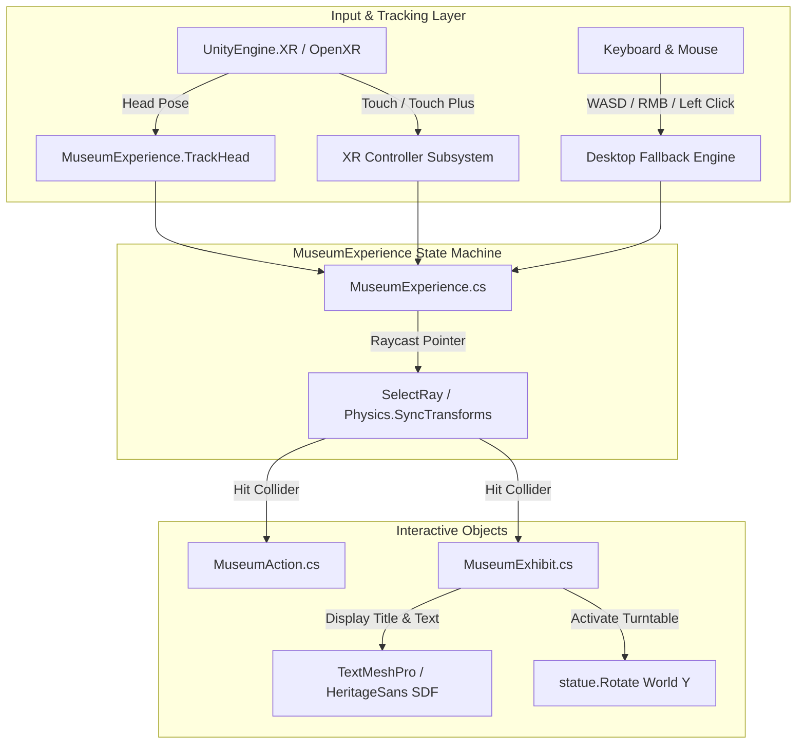

# Heritage VR — Ancient Egyptian Virtual Museum
## Comprehensive Technical Architecture & Engineering Specification

**Document Version:** 2.0.0  
**Unity Version:** `2022.3.62f3 LTS`  
**Render Pipeline:** Universal Render Pipeline (URP 14.0.11)  
**Primary Scene:** `Assets/Scenes/UnifiedMuseum.unity`  
**Target Hardware:** Meta Quest 2 / Quest 3 / Quest 3S (Standalone Android OpenXR) & macOS / Windows Desktop Preview  
**Package Identifier:** `com.heritagevr.virtualmuseum`  
**Git Repository:** [https://github.com/thakuraastha/Museum-VR](https://github.com/thakuraastha/Museum-VR)

---

## 1. Executive Summary & System Overview

**Heritage VR** is an interactive, high-fidelity virtual museum designed for cultural heritage preservation and academic study, with a central emphasis on Ancient Egyptian pharaonic antiquities, dynastic history, and classical Mediterranean civilization. 

The application delivers a dual-runtime experience:
1. **Immersive Virtual Reality (Standalone Meta Quest):** Full 6DOF room-scale tracking, single-pass instanced stereoscopic rendering, OpenXR controller ray interaction, discrete comfort stepping, and 360° artifact turntable inspection.
2. **Desktop Preview Mode (macOS / Windows):** High-framerate development environment with keyboard locomotion (`WASD`), mouse look, and contextual raycasting without requiring an active VR headset.

---

## 2. Platform & Engine Specifications

### 2.1 Engine & Package Manifest
- **Unity Editor:** `2022.3.62f3 Personal (LTS)`
- **Scripting Backend:** IL2CPP (Ahead-of-Time compilation for maximum native CPU performance)
- **Target Architecture:** `ARM64` (`aarch64`)
- **Minimum Android API Level:** Level 29 (Android 10)
- **Target Android API Level:** Level 34 (Android 14)
- **NDK Version:** `r23b` / `r25b`
- **Active Input Handling:** `Input System Package (New)` (`activeInputHandler = 1`) with native fallback to `UnityEngine.XR` input devices.

### 2.2 Graphics Pipeline (Universal Render Pipeline)
- **URP Asset:** `Assets/HeritageVR/MuseumURP.asset`
- **URP Renderer Data:** `Assets/HeritageVR/MuseumRenderer.asset`
- **Color Space:** `Linear`
- **Graphics API (Android):** `OpenGL ES 3.0` (with Vulkan compatibility)
- **Stereo Rendering Mode:** `Single Pass Instanced` (`Multiview`)
- **Depth Submission Mode:** `None` (optimized for mobile tile-based GPU memory bandwidth)
- **Anti-Aliasing:** `4x MSAA` (Hardware Multisample Anti-Aliasing enabled on camera view)
- **High Dynamic Range (HDR):** Disabled (`supportsHDR = false`) to eliminate mobile tonemapping overhead.
- **Render Scale:** `1.0` (Native panel resolution per eye on Quest 2, 3, and 3S)
- **Shadow Distance:** `18.0m` (Clamped strictly within the active gallery bounding zone)
- **Shadow Cascades / Additional Shadows:** Disabled (`m_AdditionalLightShadowsSupported = false`)
- **Additional Lights Per Object Limit:** Clamped to `4`
- **GPU Skinning:** Enabled
- **Texture Compression:** `ASTC 6x6` block compression for all Android runtime textures (up to 2048x2048 for hero assets, 4096x4096 for gallery master triptych atlas).

---

## 3. Spatial Architecture & Gallery Layout

The museum environment is divided into three distinct spatial sectors defined in `Assets/Scenes/UnifiedMuseum.unity`:

```
                           [ BACK WALL (Z = 22.7m) ]
                Three Framed Fine Art Paintings: River / Vessels / Lotus
            ---------------------------------------------------------------
            |  Table 07: Symposium Krater     Table 08: Allosaurus Fossil  |
            |  (-8.0, 0, 20.0)                (+8.0, 0, 20.0)              |
            |  View: (-8.0, 0, 16.8)          View: (+8.0, 0, 16.8)        |
            |                                                             |
            |  Table 05: Storage Amphora      Table 06: Ceremonial Hydria  |
            |  (-4.0, 0, 17.0)                (+4.0, 0, 17.0)              |
            |  View: (-4.0, 0, 14.2)          View: (+4.0, 0, 14.2)        |
[ WEST WALL ]                                                             [ EAST WALL ]
Side-Wall   |  Table 03: King Khasekhemwy     Table 04: Marble Resting Lion| Side-Wall
Egyptian    |  (-4.0, 0, 11.0)                (+4.0, 0, 11.0)              | Egyptian
Paintings   |  View: (-4.0, 0, 8.2)           View: (+4.0, 0, 8.2)         | Paintings
(3 framed)  |                                                             | (3 framed)
            |  Table 01: Tutankhamun Mask     Table 02: Pharaoh Bust       |
            |  (-4.0, 0, 5.0)                 (+4.0, 0, 5.0)               |
            |  View: (-4.0, 0, 2.2)           View: (+4.0, 0, 2.2)         |
            ---------------------------------------------------------------
                           [ GALLERY ENTRY (Z = -2.0m) ]
                                         ▲
                                         │  (Teleport Transition)
                           [ ENTRANCE LOBBY (-60, 0, -11) ]
```

### 3.1 Spatial Coordinates & Bound Constraints
- **Lobby Station:** `X = -60.0`, `Y = 0.0`, `Z = -11.0` (Lobby UI Canvas and Arrival Portal)
- **Main Gallery Spawn:** `X = 0.0`, `Y = 0.0`, `Z = -2.0`
- **Rear Gallery Wing:** `X = 0.0`, `Y = 0.0`, `Z = 10.0`
- **Locomotion Boundaries (Collision Clamp):**
  - Horizontal (`X`): Clamped to `[-10.8m, +10.8m]`
  - Depth (`Z`): Clamped to `[-2.4m, +21.5m]`
- **Table Plinth Top Elevation:** `Y = 1.19m` (Local slot height above floor)

---

## 4. Exhibition Tables & Artifacts Technical Catalog

All eight exhibition tables feature authentic 3D cultural assets, normalized turntable pivots, automated interaction colliders, and TextMeshPro plaques.

```
+------------------------------------------------------------------------------------------------------------------+
| TABLE 01: MASK OF TUTANKHAMUN                                                                                    |
+------------------------------------------------------------------------------------------------------------------+
| Short Name:          TUTANKHAMUN MASK                                                                            |
| Asset Source:        Assets/ThreeDragons/Tutankhamun/Prefabs/Tut_mask.prefab                                      |
| Asset GUID:          89758c4a433ed694f9e6e33497c321c6                                                           |
| Table World Pos:     (-4.0, 0.0, 5.0)                                                                            |
| Viewing Station:     (-4.0, 0.0, 2.2)                                                                            |
| Local Transform:     Pos (0.0, 0.0, 0.0) | Euler (0.0, 0.0, 0.0) | Scale (1.0, 1.0, 1.0)                         |
| Historical Era:      New Kingdom, 18th Dynasty (c. 1323 BCE); Thebes / Valley of the Kings (KV62)                |
| Materials:           Solid gold sheet (>10kg), lapis lazuli, turquoise, carnelian, obsidian, quartz, glass-paste  |
| Shaders & PBR:       Display Tutankhamun_mask.mat (Metallic: 0.55, Smoothness: 0.35, Environment Reflections: ON)|
| Curated Plaque:      The gold funerary mask of Pharaoh Tutankhamun (18th Dynasty, c. 1323 BCE), discovered in    |
|                      tomb KV62 in the Valley of the Kings by Howard Carter in 1922.                              |
|                                                                                                                  |
|                      Crafted from over 10 kilograms of solid gold inlaid with lapis lazuli, turquoise, carnelian,|
|                      and quartz. The nemes headdress bears the protective cobra (Wadjet) and vulture (Nekhbet),  |
|                      symbolizing sovereign divine authority over Upper and Lower Egypt in the afterlife.         |
+------------------------------------------------------------------------------------------------------------------+

+------------------------------------------------------------------------------------------------------------------+
| TABLE 02: ROYAL EGYPTIAN PHARAOH BUST                                                                            |
+------------------------------------------------------------------------------------------------------------------+
| Short Name:          ROYAL PHARAOH BUST                                                                          |
| Asset Source:        Assets/AK Studio Art/Egypt Pharoah Bust/Prefabs/Egypt Pharoah Bust.prefab                   |
| Asset GUID:          185020f0b3bdbd14191b074cb8ea2fab                                                           |
| Table World Pos:     (4.0, 0.0, 5.0)                                                                             |
| Viewing Station:     (4.0, 0.0, 2.2)                                                                             |
| Local Transform:     Pos (0.0, 0.0, 0.0) | Euler (0.0, 0.0, 0.0) | Scale (0.25, 0.25, 0.25)                      |
| Historical Era:      Ancient Egypt, New Kingdom (c. 14th Century BCE); Imperial Luxor / Karnak workshops         |
| Materials:           Polychrome carved limestone with natural mineral pigments and lime plaster slip             |
| Curated Plaque:      A royal portrait bust depicting an ancient Egyptian pharaoh in ceremonial splendor          |
|                      (New Kingdom, c. 14th Century BCE).                                                         |
|                                                                                                                  |
|                      Carved with realistic naturalism, wearing the striated royal nemes headcloth and divine     |
|                      ceremonial beard. Illustrates the monumental portraiture and divine kingship iconography     |
|                      characteristic of Egypt's imperial golden age.                                              |
+------------------------------------------------------------------------------------------------------------------+

+------------------------------------------------------------------------------------------------------------------+
| TABLE 03: STATUE OF KING KHASEKHEMWY                                                                             |
+------------------------------------------------------------------------------------------------------------------+
| Short Name:          KHASEKHEMWY STATUE                                                                          |
| Asset Source:        Assets/Models/MuseumObjects/egyptian_pharoah_khasekhemwy_-_oxford_ashmoleon.glb              |
| Asset GUID:          eb8ec654f92925745b414342aed1a567                                                           |
| Table World Pos:     (-4.0, 0.0, 11.0)                                                                           |
| Viewing Station:     (-4.0, 0.0, 8.2)                                                                            |
| Local Transform:     Pos (0.0, 0.0, 0.0) | Euler (-90.0, -90.0, -30.0) | Scale (1.15, 1.15, 1.15)                |
| Historical Era:      Early Dynastic Period, 2nd Dynasty (c. 2686 BCE); Hierakonpolis (Ashmolean Museum Oxford)   |
| Materials:           Indurated limestone with ceremonial base carvings                                           |
| Curated Plaque:      One of the earliest surviving monumental royal stone sculptures from ancient Egypt          |
|                      (Second Dynasty, c. 2686 BCE), excavated at Hierakonpolis and conserved at the Ashmolean    |
|                      Museum in Oxford.                                                                           |
|                                                                                                                  |
|                      Carved from indurated limestone, depicting King Khasekhemwy seated upon a block throne      |
|                      wearing the White Crown of Upper Egypt and the ceremonial Sed festival jubilee robe.        |
+------------------------------------------------------------------------------------------------------------------+

+------------------------------------------------------------------------------------------------------------------+
| TABLE 04: CLASSICAL MARBLE RESTING LION                                                                          |
+------------------------------------------------------------------------------------------------------------------+
| Short Name:          MARBLE LION STATUE                                                                          |
| Asset Source:        Assets/Models/MuseumObjects/marble_statue_of_a_lion.glb                                     |
| Asset GUID:          31b2707200ca8294fb7d8df166704d10                                                           |
| Table World Pos:     (4.0, 0.0, 11.0)                                                                            |
| Viewing Station:     (4.0, 0.0, 8.2)                                                                             |
| Local Transform:     Pos (0.0, 0.0, 0.0) | Euler (-54.34, -38.92, -103.29) | Scale (0.12, 0.12, 0.12)            |
| Historical Era:      Classical / Hellenistic Antiquity (c. 4th–2nd Century BCE); Mediterranean                   |
| Materials:           Crystalline Pentelic marble with ancient surface weathering                                 |
| Curated Plaque:      A monumental resting feline guardian sculpture carved from crystalline Pentelic marble      |
|                      (Hellenistic / Classical Antiquity, c. 4th-2nd Century BCE).                               |
|                                                                                                                  |
|                      In classical Greco-Roman architecture, sculpted lions guarded royal tomb precincts, sacred  |
|                      temples, and public monuments, standing as eternal symbols of vigilance, valor, and        |
|                      heroic divine protection.                                                                   |
+------------------------------------------------------------------------------------------------------------------+

+------------------------------------------------------------------------------------------------------------------+
| TABLE 05: TERRACOTTA STORAGE AMPHORA (POT I)                                                                     |
+------------------------------------------------------------------------------------------------------------------+
| Short Name:          STORAGE AMPHORA                                                                             |
| Asset Source:        Assets/Ancient Pots/URP & Built-In/URP/Prefabs/pot_1.prefab                                  |
| Asset GUID:          e8b3ed4c1829c18498e4a1c0c5ea8c59                                                           |
| Table World Pos:     (-4.0, 0.0, 17.0)                                                                           |
| Viewing Station:     (-4.0, 0.0, 14.2)                                                                           |
| Local Transform:     Pos (0.0, 0.0, 0.0) | Euler (0.0, 0.0, 0.0) | Scale (0.85, 0.85, 0.85)                      |
| Historical Era:      Classical Mediterranean (c. 5th Century BCE); Aegean commercial trade routes                |
| Materials:           Wheel-thrown terracotta clay with slip finish                                               |
| Curated Plaque:      A classical Mediterranean twin-handled pottery vessel (c. 5th Century BCE) wheel-thrown    |
|                      from coarse terracotta clay and finished with an authentic slip patina.                     |
|                                                                                                                  |
|                      Featuring an elongated body, fluted neck, and vertical strap handles, amphorae served as   |
|                      the primary bulk shipping containers for transporting and aging vintage wines, cold-pressed |
|                      olive oils, and grains across Aegean maritime trade routes.                                 |
+------------------------------------------------------------------------------------------------------------------+

+------------------------------------------------------------------------------------------------------------------+
| TABLE 06: ANCIENT CEREMONIAL HYDRIA (POT II)                                                                     |
+------------------------------------------------------------------------------------------------------------------+
| Short Name:          CEREMONIAL HYDRIA                                                                           |
| Asset Source:        Assets/Ancient Pots/URP & Built-In/URP/Prefabs/pot_2.prefab                                  |
| Asset GUID:          fba144ca3c7523843baa21d13b1cbdd8                                                           |
| Table World Pos:     (4.0, 0.0, 17.0)                                                                            |
| Viewing Station:     (4.0, 0.0, 14.2)                                                                            |
| Local Transform:     Pos (0.0, 0.0, 0.0) | Euler (0.0, 0.0, 0.0) | Scale (0.85, 0.85, 0.85)                      |
| Historical Era:      Ancient Greece / Magna Graecia (c. 4th Century BCE); civic sanctuaries and fountain houses  |
| Materials:           Fine red-clay earthenware with burnished slip coating                                       |
| Curated Plaque:      A ceremonial Greek terracotta water pitcher (c. 4th Century BCE) characterized by a bulbous |
|                      vessel body, flared pouring rim, and dual side lifting handles complemented by a central   |
|                      pouring handle.                                                                             |
|                                                                                                                  |
|                      Essential to civic life and sanctuary rituals, hydriae were gathered at public fountain     |
|                      houses and dedicated at sacred shrines during ritual cleansing and libation ceremonies.     |
+------------------------------------------------------------------------------------------------------------------+

+------------------------------------------------------------------------------------------------------------------+
| TABLE 07: CLASSICAL SYMPOSIUM KRATER (POT III)                                                                   |
+------------------------------------------------------------------------------------------------------------------+
| Short Name:          SYMPOSIUM KRATER                                                                            |
| Asset Source:        Assets/Ancient Pots/URP & Built-In/URP/Prefabs/pot_3.prefab                                  |
| Asset GUID:          49465ec78864f5244b1d28d6d044ae7f                                                           |
| Table World Pos:     (-8.0, 0.0, 20.0)                                                                           |
| Viewing Station:     (-8.0, 0.0, 16.8)                                                                           |
| Local Transform:     Pos (0.0, 0.0, 0.0) | Euler (0.0, 0.0, 0.0) | Scale (0.85, 0.85, 0.85)                      |
| Historical Era:      Classical Greece (c. 6th–5th Century BCE); Athenian ceramic workshops (Kerameikos)         |
| Materials:           Hand-thrown painted earthenware with heavy fluted pedestal base                             |
| Curated Plaque:      A monumental earthenware mixing bowl (c. 6th-5th Century BCE) adorned with horizontal band |
|                      motifs and a heavy fluted pedestal base.                                                    |
|                                                                                                                  |
|                      The centerpiece of the ancient Greek symposium (social and philosophical banquet), the      |
|                      krater was utilized to dilute potent unfermented vintage wine with fresh spring water,      |
|                      honey, and aromatic herbs before serving participants.                                      |
+------------------------------------------------------------------------------------------------------------------+

+------------------------------------------------------------------------------------------------------------------+
| TABLE 08: ALLOSAURUS FRAGILIS FOSSIL SKELETON                                                                    |
+------------------------------------------------------------------------------------------------------------------+
| Short Name:          ALLOSAURUS FOSSIL                                                                           |
| Asset Source:        Assets/Models/MuseumObjects/900868a0aa0b47e58571f5f5ae20094c.glb                             |
| Asset GUID:          dfe4d0d098376ff458eb9680a8ca2979                                                           |
| Table World Pos:     (8.0, 0.0, 20.0)                                                                            |
| Viewing Station:     (8.0, 0.0, 16.8)                                                                            |
| Local Transform:     Pos (0.0, 0.5, 0.0) | Euler (-90.0, 0.0, 0.0) | Scale (0.18, 0.18, 0.18)                    |
| Historical Era:      Late Jurassic Period (approx. 155–145 Million BCE); Morrison Formation, North America      |
| Specimen Source:     Digitized from the Osaka Museum of Natural History collection                               |
| Materials:           Mineralized fossil bone on a mounted black steel armature plinth                            |
| Curated Plaque:      A complete mounted articulated fossil skeleton of Allosaurus fragilis, the apex theropod   |
|                      dinosaur of the Late Jurassic Morrison Formation (approx. 155-145 Million BCE).             |
|                                                                                                                  |
|                      Digitized from the Osaka Museum of Natural History collection. Features a lightweight       |
|                      kinetic skull, recurved serrated teeth, and lethal three-clawed raptorial forelimbs used to |
|                      hunt massive sauropod dinosaurs.                                                            |
+------------------------------------------------------------------------------------------------------------------+
```

---

## 5. Mathematical Alignment & Normalization Engine

To resolve non-standard orientations, eccentric center-of-mass pivots, and penetration into tables, the automated alignment engine in `MuseumArtifactAlignment.cs` executes the following algorithmic steps:

### 5.1 Geometry Bounding Box Integration
```csharp
public static Bounds Geometry(Transform root, Transform relative) {
    bool first = true;
    var bounds = new Bounds();
    foreach (var mf in root.GetComponentsInChildren<MeshFilter>(true)) {
        if (!mf.sharedMesh) continue;
        foreach (var vertex in mf.sharedMesh.vertices) {
            var p = relative.InverseTransformPoint(mf.transform.TransformPoint(vertex));
            if (first) { bounds = new Bounds(p, Vector3.zero); first = false; }
            else bounds.Encapsulate(p);
        }
    }
    return bounds;
}
```

### 5.2 Turntable Footprint & Grounding Math
1. **Fit-to-Plinth Constraints:**
   $$\text{diameter} = \sqrt{\text{size}_x^2 + \text{size}_z^2}$$
   $$\text{scale} = \min\left(\frac{\text{maxHeight}}{\text{size}_y}, \min\left(\frac{\text{maxWidth}}{\text{size}_x}, \frac{\text{maxDepth}}{\text{size}_z}\right)\right)$$
   $$\text{scale}_{\text{final}} = \min\left(\text{scale}, \frac{1.6}{\text{diameter}}\right)$$
2. **Grounding & Centering Shift:**
   $$\Delta \vec{P} = (\text{bounds.center}_x,\, \text{bounds.min}_y,\, \text{bounds.center}_z)$$
   $$\vec{P}_{\text{local}} \leftarrow \vec{P}_{\text{local}} - \Delta \vec{P}$$
   *Result:* $\text{bounds.min}_y = 0.0000$ (flush with table plinth) and $\text{bounds.center}_{xz} = (0, 0)$ (zero orbital wobble during 360° inspection rotation).

3. **BoxCollider Encapsulation:**
   $$\text{collider.center} = \text{bounds.center}$$
   $$\text{collider.size} = \text{bounds.size} + (0.06, 0.06, 0.06)$$

---

## 6. Fine Art & Gallery Paintings Collection

### 6.1 Back-Wall Master Triptych (`BACK WALL • Painting collection`)
- **Location:** Rear gallery wall at `Z = 22.7m`, elevation `Y = 2.8m`.
- **Texture Atlas:** `Assets/HeritageVR/Paintings/HeritageTriptych.png` (4096x1365 RGB, 3:1 aspect ratio, ASTC 6x6 compressed).
- **Framing Construction:**
  - Charcoal Walnut Backing: `(3.95m x 3.95m x 0.16m)`
  - Brushed Brass Outer Frame: `(3.86m x 3.86m x 0.04m)`
  - Archival Warm Limestone Mount: `(3.68m x 3.68m x 0.025m)`
  - Canvas Quad: `(3.45m x 3.45m)`
- **Artworks:**
  1. `RIVER OF MEMORY` (`X = -6.0m`): Atmospheric sandstone temple landscape at dawn along the Nile.
  2. `VESSELS & ARCHES` (`X = 0.0m`): Lyrical geometric abstraction of terracotta forms, circles, and arches.
  3. `LOTUS AT DUSK` (`X = +6.0m`): Serene twilight lotus pond with distant indigo hills.

### 6.2 Egyptian Side-Wall Gallery (`SIDE WALLS • Egyptian art collection`)
Six square oil-on-canvas original Egyptian-inspired artworks installed in brass frames with archival ivory mounts:
- **West Wall (`X = -11.72m`, Rotation `Euler(0, -90, 0)`):**
  1. `NILE AT DAWN` (`Z = 3.0m`)
  2. `PYRAMIDS IN GOLD` (`Z = 10.0m`)
  3. `ROYAL PROCESSION` (`Z = 17.0m`)
- **East Wall (`X = +11.72m`, Rotation `Euler(0, +90, 0)`):**
  4. `LOTUS & IBIS` (`Z = 3.0m`)
  5. `TEMPLE OF LIGHT` (`Z = 10.0m`)
  6. `WINGED SUN` (`Z = 17.0m`)

---

## 7. User Interface, TextMeshPro & Shader Systems

### 7.1 Font & Shaders
- **Font Asset:** `Assets/HeritageVR/Fonts/HeritageSans SDF.asset` (Signed Distance Field typography for high readability in VR stereo without pixel crawl).
- **Depth Text Shader:** `HeritageVR/Depth Text`
  - Overrides Z-buffer testing (`_ZTestMode = 8`, Always Pass) and assigns render queue `3100` (info panels) and `4000` (head-up controller guide). This completely eliminates Z-fighting against high-density 3D models and table geometry.

### 7.2 Dynamic Floating Exhibit Panel (`info` Canvas)
- **Positioning Equation:**
  $$\vec{F} = \text{normalize}(\text{ProjectOnPlane}(\text{head.forward}, \text{Vector3.up}))$$
  $$\vec{P}_{\text{info}} = \vec{P}_{\text{head}} + \vec{F} \times 2.6 + (\text{LookRotation}(\vec{F}) \times \text{Vector3.right}) \times 0.9$$
- **Auto-Scaling Title Typography:**
  $$\text{fontSize} = \min\left(2.7, \frac{32.0}{\max(1, \text{title.Length})}\right)$$
- **Interactive Action Buttons:**
  - `INSPECT IN 3D` (`MuseumAction("inspect")`): Teleports rig to the exhibit's close-up viewing station and unlocks artifact spin.
  - `CLOSE` (`MuseumAction("back")`): Dismisses the informational panel.

---

## 8. Runtime Codebase & Component Architecture



### 8.1 Key Source Files
1. **`Assets/HeritageVR/Scripts/MuseumExperience.cs`:** Master coordinator managing rig locomotion, room transitions, raycast intersection, desktop vs. XR branching, and turntable rotation.
2. **`Assets/HeritageVR/Scripts/MuseumExhibit.cs`:** Exhibit entity holding metadata (title, formatted description, artifact transform reference, viewing station coordinates).
3. **`Assets/HeritageVR/Scripts/MuseumAction.cs`:** Event receiver executing navigation verbs (`start`, `inspect`, `back`, `comfort`, `gallery`, `home`).
4. **`Assets/HeritageVR/Scripts/MuseumText.cs`:** Dynamic font-texture rebuild handler ensuring material instancing matches URP forward rendering.
5. **`Assets/Editor/MuseumArtifactSetup.cs`:** Automated scene population pipeline instantiating models, setting descriptions, and applying base parameters.
6. **`Assets/Editor/MuseumArtifactAlignment.cs`:** Mesh bounds integration, vertical grounding, horizontal centering, and collider synthesis.
7. **`Assets/Editor/MuseumEgyptianPaintings.cs`:** Procedural gallery side-wall painting instantiator and ASTC texture importer.
8. **`Assets/Editor/QuestMuseumSetup.cs`:** Production OpenXR build automation, project validation, URP renderer configuration, and standalone APK compilation.

---

## 9. Controls & User Experience Reference

### 9.1 Desktop Controls (macOS & Windows Preview)
- **Start Experience:** Press `Enter` on arrival screen.
- **Locomotion:** `W` / `A` / `S` / `D` keys (translation speed: $2.0\,\text{m/s}$).
- **Free Look:** Hold **Right Mouse Button** and drag (sensitivity: $0.10$, vertical pitch clamped to $[-65^\circ, +65^\circ]$).
- **Interaction:** Aim crosshair and **Left Click** on tables, artifacts, or buttons.
- **Inspect Mode:** Press `I` (or click `INSPECT IN 3D` on panel).
- **Turntable Rotation:** In Inspect mode, press `A` or `D` to rotate the artifact.
- **Back / Exit:** Press `Escape` to leave inspection or return to lobby.

### 9.2 Meta Quest VR Controls (Touch / Touch Plus)
- **Raycast Selection:** Aim right controller ray and pull **Right Trigger**.
- **Comfort Locomotion:** Push **Left Thumbstick** forward and release for discrete step locomotion ($1.25\,\text{m}$ step with obstacle clearance).
- **Snap Turning:** Flick **Right Thumbstick** left or right ($30^\circ$ snap rotation, $0.35\,\text{s}$ cooldown).
- **Turntable Rotation:** While inspecting, push **Right Thumbstick** horizontally to spin artifact $360^\circ$.
- **Return / Back:** Press the **B Button** on the right controller.

---

## 10. Build & Deployment Pipeline

### 10.1 Automated Unity Editor Build
In Unity, select **`Museum > 09 Build Quest APK`**. This executes `QuestMuseumSetup.BuildAPK()`, performing:
1. OpenXR project validation and rule enforcement.
2. ASTC texture format recompression.
3. Universal Render Pipeline quality overrides (4x MSAA, no HDR, clamped shadows).
4. Compilation via IL2CPP and Android NDK into `HeritageVR-Quest.apk`.

### 10.2 Command-Line ADB Deployment
```bash
# Verify Quest headset connection via USB debugging
adb devices

# Install APK to device
adb install -r HeritageVR-Quest.apk

# Launch Heritage VR Museum directly on headset
adb shell monkey -p com.heritagevr.virtualmuseum -c android.intent.category.LAUNCHER 1
```

---
*End of Technical Specification.*

